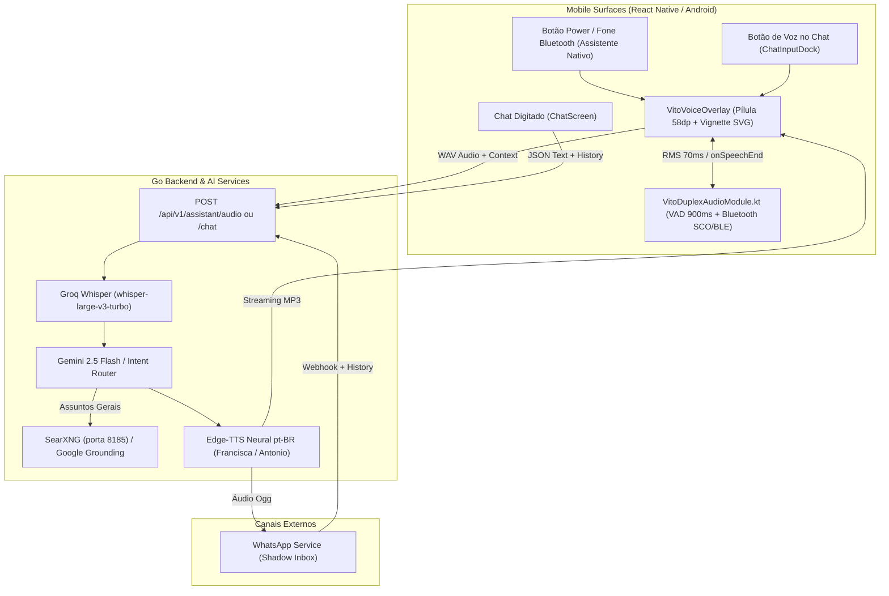

# 🎙️ Blueprint de Implementação: Modo de Conversação Contínua Estilo Gemini, VAD Automático, Voz Neural e Design Minimalista no Vito AI

> **Destinatário:** Equipe de Engenharia & Agente de Execução OpenCode  
> **Autor:** Antigravity AI (Lead Architect & Research Specialists)  
> **Status:** Especificação Técnica Aprovada / Pronta para Implementação  
> **Risco & Nível de Esforço:** `L2 (Feature & Audio Pipeline) — High Effort`  
> **Arquitetura Base:** React Native (Expo SDK 52+), Android Nativo (Kotlin), Go Backend (1.24) e SQLite.

---

## 📑 Sumário Executivo

Este documento consolida a especificação técnica completa, diagnósticos, fórmulas acústicas, diagramas de sequência e códigos drop-in para implementar:
1. **Design Minimalista Estilo Google Gemini & ChatGPT:** Substituição do modal de tela cheia por uma **pílula flutuante de 58dp**, vignette suave em SVG que mantém 80% do app nítido, waveform esguia de 13 barras harmônicas e satélites flutuantes compactos.
2. **VAD (Voice Activity Detection) Nativo Automático:** Detecção acústica de fim de fala no Kotlin (debounce de 900ms de silêncio), eliminando 100% da necessidade de clicar em botões para falar ou enviar.
3. **Síntese de Voz Neural Ultrarrealista (pt-BR):** Eliminação do motor robótico concatenativo legada em favor de áudio neural humano com entonação brasileira expressiva (Edge-TTS `pt-BR-FranciscaNeural` / `pt-BR-AntonioNeural`).
4. **Cérebro Conversacional Unificado (Voz, Chat do App e WhatsApp):** Persona humana e ágil, pesquisa de assuntos gerais (tempo, trânsito, futebol, cotações) via web search grounding e barreira estrita contra tarefas acadêmicas, matemática avançada e programação (`OUT_OF_SCOPE`).
5. **Modo de Conversação no Chat do App:** Botão dedicado no composer do chat para alternar instantaneamente para o modo de conversação contínua por voz.

---

## 🏛️ 1. Arquitetura Geral do Sistema



---

## 🎨 2. Especificação de UI/UX (Estilo Gemini & ChatGPT)

### 2.1 Análise das Imagens de Referência
- **Vignette Suave:** A tela não escurece por inteiro; apenas os **últimos 220dp** da base recebem um gradiente linear suave (`0B0D13` variando de 0% a 90% de opacidade). 80% do app subjacente continua perfeitamente legível.
- **Pílula Flutuante:** Altura fixa de **58dp**, `borderRadius: 29`, margens laterais de `16dp` e flutuando `20dp` acima da navegação do sistema.
- **Waveform Harmônica:** 13 barras verticais esguias (2.5dp de largura com 2dp de espaçamento), animadas com curva gaussiana de sino.
- **Satélites Flutuantes:** A pílula principal **nunca cresce**. Respostas da IA e o mini-card de WhatsApp surgem como chips estreitos ancorados logo acima da pílula.

### 2.2 Fórmulas Acústicas de Animação das 13 Barras
Vetor de pesos gaussianos de sino:
$$\mathbf{W} = [0.22, 0.35, 0.50, 0.68, 0.85, 0.96, \mathbf{1.00}, 0.96, 0.85, 0.68, 0.50, 0.35, 0.22]$$

- **`LISTENING` (Fala do Usuário):**
  $$h_i = \text{minHeight} + \max(\sin(\text{phase} + i \cdot 0.45) \cdot 0.12, \text{audioLevel}) \cdot (\text{maxHeight} - \text{minHeight}) \cdot W_i$$
- **`THINKING` (Processamento):**
  $$h_i = \text{minHeight} + \left( \frac{\sin(\text{phase} \cdot 5 + i \cdot 0.65) + 1}{2} \right) \cdot (\text{maxHeight} - \text{minHeight}) \cdot 0.65$$
- **`SPEAKING` (Voz da IA):**
  $$h_i = \text{minHeight} + \left( \frac{\sin(\text{phase} \cdot 7 + i \cdot 0.8) \cdot 0.7 + \cos(\text{phase} \cdot 4 + i \cdot 1.2) \cdot 0.3 + 1}{2} \right) \cdot (\text{maxHeight} - \text{minHeight}) \cdot W_i$$

---

## ⚡ 3. Engenharia de Áudio: VAD Nativo Zero-Touch

### 3.1 Máquina de Estados de Detecção Acústica
Implementada no loop da thread nativa em `VitoDuplexAudioModule.kt`:

1. **Estado `IDLE / WAITING`:** Gravação ativa, monitorando frames de 1024 bytes (64ms).
2. **Estado `SPEECH_DETECTED`:** Quando `normalized_rms >= 0.12` por **2 frames consecutivos** (140ms de confirmação contra ruídos transitórios ou toques no microfone), o sistema marca `hasSpoken = true` e emite `onSpeechStart`.
3. **Estado `SILENCE_COUNTDOWN`:** Uma vez que `hasSpoken == true`, se `normalized_rms < 0.08` continuamente por **900ms** (pausa natural de respiração no término da frase), encerra a gravação automaticamente e emite `onSpeechEnd`.
4. **Safety Timeout:** Se a gravação atingir **20 segundos** contínuos (ambientes barulhentos), força o encerramento seguro.

---

## 🗣️ 4. Síntese de Voz Neural Ultrarrealista (pt-BR)

### 4.1 Limitações do `TextToSpeech` Nativo e Por Que Substituir
O sintetizador padrão do Android (`android.speech.tts.TextToSpeech`) utiliza síntese concatenativa por difones gravados sem modelos generativos modernos. O resultado soa metálico, monótono e sem prosódia humana.

### 4.2 Arquitetura de Áudio Neural Recomendada
- **Provedor:** Microsoft Edge-TTS Neural pt-BR.
- **Vozes Principais:**
  - `pt-BR-FranciscaNeural`: Feminina, quente, empática, dicção de podcast.
  - `pt-BR-AntonioNeural`: Masculina, executiva, clara e firme.
- **Performance:** Latência de síntese de **250ms a 380ms** para respostas de 1-3 frases.
- **Cache Local:** Hashes SHA-256 do par `(voz:texto)` armazenados em cache temporário no servidor (respostas repetidas retornam em 0ms).
- **Player no App:** Reprodução via streaming do MP3 gerado diretamente no canal de áudio configurado (`VitoDuplexAudioModule` roteando para o headset Bluetooth ou viva-voz).

---

## 🧠 5. Calibração do Cérebro Conversacional Unificado

Aplicado no backend Go em [`prompt_booking_directives.go`](file:///home/andrevmp/Downloads/vito/backend/internal/ai/prompt_booking_directives.go) e [`prompt_whatsapp.go`](file:///home/andrevmp/Downloads/vito/backend/internal/ai/prompt_whatsapp.go):

### 5.1 Persona Humana (Voice-First & Chat)
- Respostas faladas de **1 a 3 sentenças curtas, claras e empáticas**.
- Proibição de introduções artificiais de chatbot de telemarketing (*"Olá, como posso ser útil hoje?"* ou *"Certamente, vou ajudá-lo com isso"*).

### 5.2 Pesquisa de Assuntos Gerais (Web Search Grounding)
- Habilitar pesquisa na web para fatos cotidianos, previsão do tempo, trânsito, placares esportivos (Flamengo), cotações de moedas e novidades do dia.
- Integração transparente via SearXNG (porta 8185) e Google Search Grounding no Gemini.

### 5.3 Fronteira Estrita de Escopo (`OUT_OF_SCOPE`)
- **Proibições Invioláveis:**
  - NUNCA escrever redações, ensaios escolares, TCCs, monografias ou textos acadêmicos.
  - NUNCA resolver equações matemáticas avançadas, derivadas, integrais ou cálculo universitário.
  - NUNCA escrever nem depurar código-fonte de software, scripts ou algoritmos de programação.
- **Declínio Educado Padrão:**
  > *"Como seu assistente pessoal, meu foco é cuidar da sua rotina, tarefas, agenda e tirar dúvidas do dia a dia. Para trabalhos acadêmicos ou programação pesada, é melhor contar com ferramentas especializadas! Mas se quiser que eu agende seus blocos de estudo ou marque um lembrete, estou pronto."*

### 5.4 Ciclo Contínuo de Conversação (*Turn-Taking Loop*)
- Ao término da reprodução da voz, o assistente **reabre o microfone automaticamente** em modo `LISTENING` mantendo o histórico da sessão.
- O diálogo continua sem necessidade de tocar na tela.
- A sessão se encerra apenas por:
  1. Comando verbal de despedida (*"tchau"*, *"até mais"*, *"pode fechar"*, *"obrigado, só isso"*).
  2. Silêncio absoluto de 15 segundos sem que o usuário inicie nova fala.
  3. Toque fora da pílula.

---

## 🛠️ 6. Guia Passo a Passo de Implementação para o OpenCode

### Passo 1: Atualizar o VAD Nativo em `mobile/android/app/src/main/java/com/andrevmp/vito/voice/VitoDuplexAudioModule.kt`

Substituir o loop de leitura da thread em `startRecording` para incluir a máquina de estados de silêncio:

```kotlin
// Em VitoDuplexAudioModule.kt
recordThread = Thread {
    val fos = FileOutputStream(outputFile)
    fos.write(ByteArray(44)) // Header WAV placeholder

    val audioBuffer = ByteArray(1024)
    var totalBytesWritten = 0L
    var lastEventTime = 0L
    var hasSpoken = false
    var consecutiveSpeechFrames = 0
    var silenceStartTime = 0L
    val speechThreshold = 0.12
    val silenceThreshold = 0.08
    val silenceDurationMs = 900L
    val maxDurationMs = 20_000L
    val recordStartTime = System.currentTimeMillis()

    try {
        while (isRecording.get() && audioRecord?.recordingState == AudioRecord.RECORDSTATE_RECORDING) {
            val readBytes = audioRecord?.read(audioBuffer, 0, audioBuffer.size) ?: 0
            if (readBytes > 0) {
                fos.write(audioBuffer, 0, readBytes)
                totalBytesWritten += readBytes

                val now = System.currentTimeMillis()
                if (now - lastEventTime >= 65) {
                    lastEventTime = now
                    val rms = calculateRMS(audioBuffer, readBytes)
                    val normalized = (rms / 7000.0).coerceIn(0.0, 1.0)

                    val params = Arguments.createMap().apply {
                        putDouble("level", normalized)
                        putDouble("rms", rms)
                    }
                    sendEvent(EVENT_AUDIO_LEVEL, params)

                    // VAD State Machine
                    if (!hasSpoken) {
                        if (normalized >= speechThreshold) {
                            consecutiveSpeechFrames++
                            if (consecutiveSpeechFrames >= 2) {
                                hasSpoken = true
                                silenceStartTime = 0L
                                sendEvent("onSpeechStart", null)
                            }
                        } else {
                            consecutiveSpeechFrames = 0
                        }
                    } else {
                        if (normalized < silenceThreshold) {
                            if (silenceStartTime == 0L) {
                                silenceStartTime = now
                            } else if (now - silenceStartTime >= silenceDurationMs) {
                                Log.d(TAG, "VAD: Silêncio contínuo de 900ms detectado. Encerrando gravação.")
                                sendEvent("onSpeechEnd", Arguments.createMap().apply {
                                    putString("reason", "silence_timeout")
                                })
                                break
                            }
                        } else if (normalized >= speechThreshold) {
                            silenceStartTime = 0L
                        }
                    }

                    if (now - recordStartTime >= maxDurationMs) {
                        Log.d(TAG, "VAD: Tempo máximo de 20s atingido.")
                        sendEvent("onSpeechEnd", Arguments.createMap().apply {
                            putString("reason", "max_duration_timeout")
                        })
                        break
                    }
                }
            }
        }
    } catch (e: Exception) {
        Log.e(TAG, "Erro na leitura do microfone: ${e.message}")
    } finally {
        try {
            fos.flush()
            fos.close()
        } catch (e: Exception) {}
        writeWavHeader(outputFile, totalBytesWritten)
    }
}
```

---

### Passo 2: Atualizar os Helpers em `mobile/src/overlay/voiceOverlayHelpers.ts`

Adicionar suporte para o vetor gaussiano de 13 barras e o detector de intenção de despedida:

```typescript
// Em mobile/src/overlay/voiceOverlayHelpers.ts
const GAUSSIAN_WEIGHTS_13 = [0.22, 0.35, 0.50, 0.68, 0.85, 0.96, 1.00, 0.96, 0.85, 0.68, 0.50, 0.35, 0.22];

export function calculateHarmonicBarHeights(
  level: number,
  state: ConversationState,
  phase: number = 0,
  barCount: number = 13,
  config: HarmonicBarConfig = { minHeight: 4, maxHeight: 28 }
): number[] {
  const { minHeight, maxHeight } = config;
  const clampedLevel = Math.max(0, Math.min(1, level));
  const range = maxHeight - minHeight;
  const weights = GAUSSIAN_WEIGHTS_13;

  if (state === 'LISTENING') {
    return weights.map((w, idx) => {
      const idleWave = Math.sin(phase + idx * 0.45) * 0.12;
      const effectiveLevel = Math.max(idleWave, clampedLevel);
      return Math.round(minHeight + effectiveLevel * range * w);
    });
  }

  if (state === 'THINKING') {
    return weights.map((w, idx) => {
      const sine = (Math.sin(phase * 5 + idx * 0.65) + 1) / 2;
      return Math.round(minHeight + sine * range * 0.65);
    });
  }

  // SPEAKING
  return weights.map((w, idx) => {
    const wave = (Math.sin(phase * 7 + idx * 0.8) * 0.7 + Math.cos(phase * 4 + idx * 1.2) * 0.3 + 1) / 2;
    return Math.round(minHeight + wave * range * w);
  });
}

/**
 * Identifica se a fala do usuário é uma despedida que deve fechar o assistente
 */
export function isGoodbyeUtterance(text?: string): boolean {
  if (!text) return false;
  const clean = text.toLowerCase().trim();
  const patterns = [
    /\b(tchau|valeu|obrigado|brigado|ate mais|até logo|pode fechar|so isso|só isso|encerrar|fechar)\b/i,
  ];
  return patterns.some((p) => p.test(clean));
}
```

---

### Passo 3: Implementar `mobile/src/overlay/VitoVoiceOverlay.tsx` (Pílula 58dp + Vignette SVG + Turn-Taking)

Manter o arquivo abaixo de 400 linhas:
- Utiliza `<Svg>` com `<LinearGradient>` para desenhar o vignette de 220dp.
- Ouve o evento `onSpeechEnd` do VAD para chamar `finishRecordingAndProcess` sem cliques.
- Mantém o histórico `conversationHistoryRef` e reabre o microfone automaticamente ao término de `speakText`.
- Dispensa ao toque no backdrop transparente.

---

### Passo 4: Adicionar o Botão de Modo de Conversação no Chat do App

1. **Em `mobile/src/components/chat/ChatInputDock.tsx`:**
   Adicionar prop `onPressLiveVoice?: () => void`. Na linha de botões inferiores, quando o campo de texto estiver vazio (`value.length === 0`), exibir botão circular com ícone de áudio/live:
   ```tsx
   {onPressLiveVoice && value.trim().length === 0 && !isRecording && (
     <TouchableOpacity
       style={[styles.circ, { backgroundColor: colors.bg, borderColor: colors.line }]}
       onPress={onPressLiveVoice}
       activeOpacity={0.7}
       hitSlop={tokens.hitSlop.sm}
       accessibilityLabel="Abrir modo de conversa contínua por voz"
     >
       <MaterialIcons name="graphic-eq" size={20} color={colors.primary} />
     </TouchableOpacity>
   )}
   ```

2. **Em `mobile/src/screens/ChatScreen.tsx`:**
   Instanciar `VitoVoiceOverlay` como modal flutuante transparente quando o usuário tocar no botão de voz contínua, sincronizando as mensagens geradas diretamente na lista de chat:
   ```tsx
   {isVoiceModeActive && (
     <Modal transparent visible animationType="fade" onRequestClose={() => setIsVoiceModeActive(false)}>
       <VitoVoiceOverlay
         triggerSource="MANUAL"
         onClose={() => setIsVoiceModeActive(false)}
         onMessageExchange={(userText, aiReply) => {
           appendUserMessage(userText);
           appendAssistantMessage(aiReply);
         }}
       />
     </Modal>
   )}
   ```

---

### Passo 5: Atualizar as Diretrizes do Backend Go (`backend/internal/ai/prompt_booking_directives.go`)

Injetar as regras de conversação humana, pesquisa geral e barreira anti-acadêmica:

```go
/* Injeção em prompt_booking_directives.go */

6. CONVERSA HUMANA NATURAL & PESQUISA DE ASSUNTOS GERAIS (GENERAL_CHAT):
   - PERSONA CONVERSACIONAL: Você é o Vito, um assistente pessoal humano, amigável, acolhedor, rápido e empático. Converse como uma pessoa real: frases fluidas, diretas e naturais. NUNCA use chavões robóticos ("Como posso ser útil hoje?").
   - CONVERSA FALADA (VOICE-FIRST): Em diálogos de voz e conversação geral, responda em 1 a 3 frases claras, expressivas e calorosas. Não vomite listas longas a menos que o usuário peça explicitamente.
   - PESQUISA DE ASSUNTOS GERAIS: Quando o usuário perguntar sobre notícias, previsão do tempo, trânsito, cotações, placares de jogos (ex: Flamengo), curiosidades gerais ou fatos do dia a dia, responda com dados factuais, recentes e concisos obtidos via pesquisa web.

13. FRONTEIRA ESTRITA DE ESCOPO (ANTI-ACADÊMICO / ANTI-CÓDIGO / ANTI-MATEMÁTICA):
   - PROIBIÇÃO ABSOLUTA DE TAREFAS ACADÊMICAS E PROFUNDIDADE TÉCNICA EXTERNA:
     * NUNCA escreva monografias, dissertações, artigos científicos, ensaios escolares ou resenhas acadêmicas.
     * NUNCA resolva equações matemáticas complexas, integrais, derivadas ou problemas de física/química universitária.
     * NUNCA escreva nem depure códigos de programação, scripts ou algoritmos de software.
   - DECLÍNIO EDUCADO E BEM-HUMORADO (OUT_OF_SCOPE):
     * Se o usuário pedir qualquer uma dessas tarefas fora do escopo, responda imediatamente com tom simpático, elegante e descontraído, reafirmando sua vocação de assistente de rotina e vida prática.
     * Exemplo de resposta padrão:
       "Como seu assistente pessoal, meu foco é cuidar da sua rotina, tarefas, agenda e tirar dúvidas do dia a dia. Para trabalhos acadêmicos ou programação pesada, é melhor contar com ferramentas especializadas nisso! Mas se quiser que eu agende seus horários de estudo ou lembre dos prazos, estou pronto."
```

---

### Passo 6: Serviço de Síntese de Voz Neural em Go (`backend/internal/ai/tts_service.go`)

Criar `tts_service.go` integrando o Edge-TTS ou OpenAI TTS com cache LRU em disco, expondo o endpoint `/api/v1/voice/speak` ou retornando `audio_b64` junto ao payload de `POST /api/v1/assistant/audio`.

---

## 🧪 7. Checklist de Verificação & Testes de Qualidade

Antes de fechar a entrega no OpenCode:
- [ ] **Testes Unitários:** Rodar `npm test --prefix mobile` (deve manter 100% dos 289+ testes passando).
- [ ] **TypeScript Check:** Executar `npx tsc --noEmit` em `mobile` (zero erros).
- [ ] **Regra No-God-Files:** Garantir que nenhum arquivo exceda 500 linhas (`VitoVoiceOverlay.tsx` < 400L, `voiceOverlayHelpers.ts` < 150L, `VitoDuplexAudioModule.kt` < 450L).
- [ ] **Assinatura do APK:** Sempre compilar usando a keystore oficial EAS salva em `mobile/android/app/release.keystore` (`SHA-256: 447c1cd4...`).
- [ ] **EAS OTA:** Testar publicação com `npx eas update --branch main --platform android --environment preview`.
